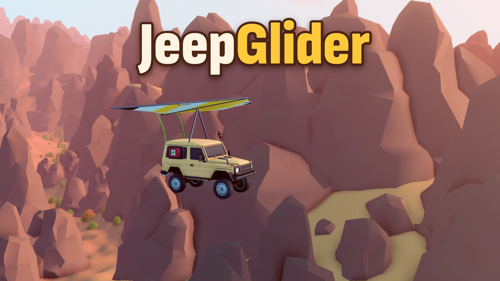

# JeepGlider



Download: [Nexus Mods](https://www.nexusmods.com/overthehill/mods/120) (mod 120).

[MelonLoader](https://github.com/LavaGang/MelonLoader) mod for Over the Hill. Adds a JeepGlider roof cosmetic, a hang glider, free in the garage, that folds up on the car's roof. Honk to open it and fly off the next ridge; honk again to fold it away.

- Honk: the mast rises and the leading edges swing out into a striped delta wing. Honk again and it folds back along the keel.
- It flies like a real hang glider: about 8:1 glide, a stall around 10 m/s, and sink if you fly it too slowly. The sail is scaled to the car's weight so every car has a hang glider's wing loading.
- Steer to bank and turn (weight shift). Left stick forward pulls the bar in to dive faster; stick back pushes it out to pull up and float.
- With the wheels on the ground it only adds lift and drag, so get some speed, or find a drop.

Requires [JoofOTHFramework](https://github.com/Jeffrharr/JoofOTHFramework), the shared Joof library.

## Install

1. Install MelonLoader 0.7.x into Over the Hill. Start the game once so it sets itself up, then quit.
2. Install [JoofOTHFramework](https://github.com/Jeffrharr/JoofOTHFramework) into the game's `UserLibs/` folder.
3. Put `JeepGlider.dll` into the game's `Mods/` folder.

## Settings

`UserData/MelonPreferences.cfg`, created on first launch, under `[JeepGlider]`:

| Setting | Default | |
|---|---|---|
| `Enabled` | `true` | The JeepGlider roof cosmetic |
| `Flight` | `true` | The open glider really flies the car (off = looks only) |
| `WingLoading` | `7` | Kilograms of car per m² of sail. Lower = floatier |
| `Stability` | `1` | How firmly it holds its glide and banks with the steering (0 = none) |
| `PitchRange` | `1` | How far the left stick pitches it (0 = off; above 1 lets you stall it) |
| `InvertPitch` | `false` | Stick back dives, stick forward pulls up |
| `OpenSeconds` | `1.5` | How long it takes to open or fold |
| `Span` | `10` | Wingspan of the model in metres (looks only) |

Multiplayer: the host runs the physics, so the host needs the mod too. Without it, the glider is for looks only. Other players see your glider if they have the mod. Stick pitch isn't part of the game's network input, so the mod sends it to the host itself, stamped with the network tick it happened on; the host applies it on that same tick, so your own game's prediction of your car stays in step with the host.

## Building

The project builds against the DLLs in your game folder, so it needs:

- .NET SDK (6.0 or newer)
- MelonLoader installed and run once, so `MelonLoader/Il2CppAssemblies/` exists
- `JoofOTHFramework.dll` in the game's `UserLibs/`

```
dotnet build
```

`GameDir` defaults to the Steam path on Linux. Override it with `-p:GameDir="/path/to/over the hill"`. The build copies the DLL into the game's `Mods/` folder.

The flight model in `GliderMath.cs` has no game dependencies and is unit tested:

```
dotnet test Tests
```

## License

[MIT](LICENSE). Not affiliated with Funselektor.
